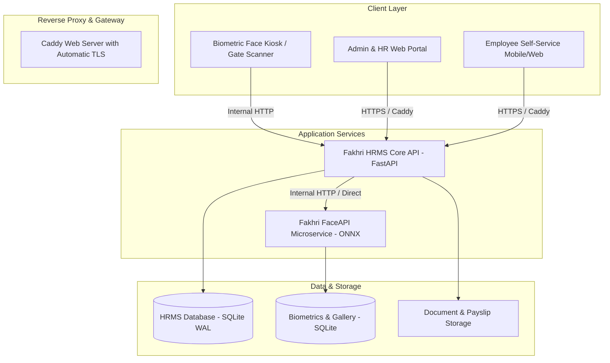
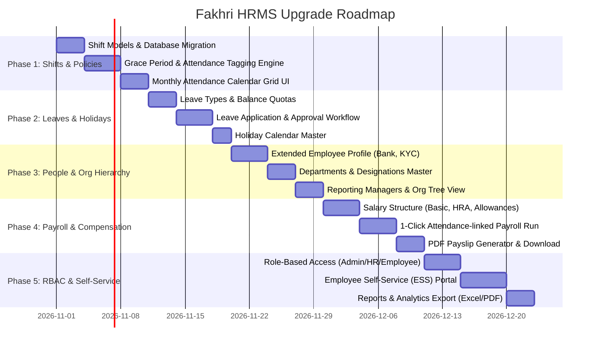

# Fakhri HRMS — Master Upgrade & Feature Enhancement Plan

> **Goal**: Transform Fakhri HRMS from a biometric attendance kiosk into a complete, modern Enterprise HRMS platform (competing directly with enterprise solutions like SignHR), while preserving and leveraging our high-speed, anti-spoofing Biometric Face Recognition engine.

---

## 1. Executive Vision & Objectives

1. **Enterprise Feature Parity**: Implement complete Employee Lifecycle, Shifts/Roster, Leave Approvals, Payroll Engine, and Multi-role Access.
2. **Biometric Edge Retained**: Keep our YuNet + SFace passive anti-spoofing engine as the primary frictionless attendance gate (<120ms identification).
3. **Modern, Responsive UI/UX**: Premium dark/light dashboard with real-time KPI metrics, interactive calendar grids, and smooth transitions.
4. **Data Integrity & Zero Downtime**: Safe database schema migrations on SQLite (WAL mode enabled), backwards-compatible with existing attendance logs and enrolled face embeddings.

---

## 2. Target Architecture Overview



---

## 3. Five-Phase Implementation Roadmap



---

### Phase 1: Shift & Attendance Policy Engine (Sprint 1)
*Objective: Upgrade attendance from raw timestamps into smart, rule-governed attendance records.*

- [ ] **Shift Master Table (`shifts`)**:
  - Shift Name (e.g. *General Shift*, *Morning Shift*, *Evening Shift*).
  - Work Timing: Start time (e.g. `09:30`), End time (e.g. `18:30`), Minimum working hours (e.g. `8.0h`).
- [ ] **Smart Policy Engine (`attendance_policies`)**:
  - **Grace Period**: Allow configurable grace (e.g., 15 minutes before marking *Late*).
  - **Late Mark Rule**: Auto-trigger penalty (e.g., 3 late marks = 0.5 day deduction).
  - **Half-Day Cutoff**: If working hours < 4.5 hours $\rightarrow$ mark as *Half Day*.
  - **Overtime (OT)**: If working hours > Shift hours + 1 hour $\rightarrow$ calculate Overtime hours.
- [ ] **Visual Attendance Calendar Grid**:
  - Monthly view showing color-coded status pills: `Present` (Green), `Late` (Orange), `Half Day` (Yellow), `Absent` (Red), `Holiday` (Blue), `On Leave` (Purple).
  - Summary cards: Total Present, Average Hours, Total Late Days, Overtime Hours.

---

### Phase 2: Leave & Holiday Management (Sprint 2)
*Objective: Full lifecycle for leave requests, balance tracking, and company holidays.*

- [ ] **Leave Types Master (`leave_types`)**:
  - Casual Leave (CL), Sick Leave (SL), Paid/Earned Leave (PL), Unpaid Leave (LWP), Maternity/Paternity Leave.
  - Yearly allowed quota per employee (e.g., CL: 12 days, SL: 8 days).
- [ ] **Leave Balance & Accrual Tracker (`leave_balances`)**:
  - Real-time balance: `Allocated` - `Used` = `Remaining`.
  - Monthly accrual or annual credit.
- [ ] **Leave Application & Approval Workflow (`leave_requests`)**:
  - Employee applies with Date range, Leave type, Reason.
  - Manager / HR approval dashboard (Approve / Reject with remarks).
  - Auto-update attendance records: approved leave marks the day as `On Leave` (preventing absent penalty).
- [ ] **Holiday Calendar Master (`holidays`)**:
  - List of national, regional, and company holidays.
  - Auto-marked on monthly attendance grid so no employee is penalized.

---

### Phase 3: Extended Employee Profile & Organization Hierarchy (Sprint 3)
*Objective: Complete digital profile and company structure.*

- [ ] **Extended Profile Fields**:
  - **Employment Details**: Date of Joining (DOJ), Employment Type (Full-time, Contract, Intern), Probation Period.
  - **Contact & Emergency**: Personal Email, Phone, Emergency Contact Name & Relation.
  - **Bank & Statutory Details**: Bank Name, Account Number, IFSC Code, PAN Card, Aadhaar Number.
  - **Address**: Current & Permanent Address.
- [ ] **Departments & Designations Master**:
  - Dropdown masters with active employee headcount tags.
- [ ] **Reporting Hierarchy & Org Structure**:
  - Assign `reporting_manager_id` to employees.
  - Visual team hierarchy view.
- [ ] **Document Storage**:
  - Upload & store employee files (ID Proof, Resume, Contract) locally/securely.

---

### Phase 4: Automated Payroll & Salary Slip Engine (Sprint 4)
*Objective: End-of-month salary computation linked to biometric attendance.*

- [ ] **Salary Structure Definition (`salary_structures`)**:
  - **Earnings**: Basic Salary, House Rent Allowance (HRA), Conveyance, Special Allowance.
  - **Deductions**: Provident Fund (PF), ESI, Professional Tax (PT), TDS/Tax, Other Deductions.
- [ ] **Attendance-Linked Payroll Processor**:
  - Formula: $\text{Payable Days} = \text{Total Month Days} - \text{Unpaid Absences} - (\text{Half Days} \times 0.5)$.
  - Auto-calculates Gross Salary, Loss of Pay (LOP) deductions, Net Payable Salary.
- [ ] **PDF Salary Slip Generator**:
  - Professional, branded PDF generation.
  - Features company logo, employee details, earnings & deductions breakdown, net pay in words, authorized signature placeholder.
  - 1-Click bulk payslip download / email dispatch.

---

### Phase 5: Role-Based Access Control (RBAC) & Employee Self-Service (Sprint 5)
*Objective: Decentralize administration while keeping strict data privacy.*

- [ ] **Role-Based Permissions**:
  - **Super Admin**: Full access to settings, payroll, face engine, server controls.
  - **HR Admin**: Manage employees, shifts, leave approvals, run payroll.
  - **Department Manager**: View team attendance, approve team leave requests.
  - **Employee**: Personal Self-Service view.
- [ ] **Employee Self-Service (ESS) Portal**:
  - Clean employee dashboard: View own monthly attendance, check leave balances, apply for leave, view and download payslips.
- [ ] **Data Export & Reporting Suite**:
  - Export attendance, leave records, and salary registers to Excel (.xlsx) and CSV with customizable date range filters.

---

## 4. Database Schema Evolution (SQLite Migration)

```sql
-- 1. Shifts Master
CREATE TABLE IF NOT EXISTS shifts (
    id TEXT PRIMARY KEY,
    name TEXT NOT NULL,
    start_time TEXT NOT NULL, -- e.g. '09:30'
    end_time TEXT NOT NULL,   -- e.g. '18:30'
    grace_minutes INTEGER DEFAULT 15,
    half_day_minutes INTEGER DEFAULT 270, -- 4.5 hours
    is_default BOOLEAN DEFAULT 0,
    created_at TIMESTAMP DEFAULT CURRENT_TIMESTAMP
);

-- 2. Leave Types Master
CREATE TABLE IF NOT EXISTS leave_types (
    id TEXT PRIMARY KEY,
    name TEXT NOT NULL,        -- 'Casual Leave', 'Sick Leave'
    code TEXT NOT NULL UNIQUE, -- 'CL', 'SL', 'PL'
    annual_days REAL NOT NULL DEFAULT 12,
    is_paid BOOLEAN DEFAULT 1,
    color TEXT DEFAULT '#38bdf8'
);

-- 3. Leave Balances
CREATE TABLE IF NOT EXISTS leave_balances (
    id TEXT PRIMARY KEY,
    employee_id TEXT NOT NULL,
    leave_type_id TEXT NOT NULL,
    year INTEGER NOT NULL,
    allocated REAL NOT NULL,
    used REAL DEFAULT 0,
    remaining REAL NOT NULL,
    FOREIGN KEY(employee_id) REFERENCES employees(id),
    FOREIGN KEY(leave_type_id) REFERENCES leave_types(id)
);

-- 4. Leave Requests
CREATE TABLE IF NOT EXISTS leave_requests (
    id TEXT PRIMARY KEY,
    employee_id TEXT NOT NULL,
    leave_type_id TEXT NOT NULL,
    start_date DATE NOT NULL,
    end_date DATE NOT NULL,
    days_count REAL NOT NULL,
    reason TEXT NOT NULL,
    status TEXT DEFAULT 'pending', -- 'pending', 'approved', 'rejected'
    approved_by TEXT,
    rejection_reason TEXT,
    created_at TIMESTAMP DEFAULT CURRENT_TIMESTAMP,
    FOREIGN KEY(employee_id) REFERENCES employees(id)
);

-- 5. Company Holidays
CREATE TABLE IF NOT EXISTS holidays (
    id TEXT PRIMARY KEY,
    name TEXT NOT NULL,
    date DATE NOT NULL UNIQUE,
    is_optional BOOLEAN DEFAULT 0
);

-- 6. Salary Structures
CREATE TABLE IF NOT EXISTS salary_structures (
    employee_id TEXT PRIMARY KEY,
    monthly_ctc REAL NOT NULL,
    basic_salary REAL NOT NULL,
    hra REAL DEFAULT 0,
    special_allowance REAL DEFAULT 0,
    pf_deduction REAL DEFAULT 0,
    esi_deduction REAL DEFAULT 0,
    pt_deduction REAL DEFAULT 0,
    tds_deduction REAL DEFAULT 0,
    FOREIGN KEY(employee_id) REFERENCES employees(id)
);

-- 7. Payroll Runs & Payslips
CREATE TABLE IF NOT EXISTS payroll_records (
    id TEXT PRIMARY KEY,
    month TEXT NOT NULL, -- '2026-10'
    employee_id TEXT NOT NULL,
    total_days INTEGER NOT NULL,
    payable_days REAL NOT NULL,
    lop_days REAL NOT NULL,
    gross_salary REAL NOT NULL,
    total_deductions REAL NOT NULL,
    net_salary REAL NOT NULL,
    status TEXT DEFAULT 'draft', -- 'draft', 'processed', 'paid'
    pdf_path TEXT,
    created_at TIMESTAMP DEFAULT CURRENT_TIMESTAMP,
    FOREIGN KEY(employee_id) REFERENCES employees(id)
);
```

---

## 5. UI/UX Enhancements & Design Patterns (Learned from SignHR Analysis)

Based on in-depth analysis of SignHR (`https://signhr.io`), we adopt the following high-converting, enterprise-grade UX patterns for Fakhri HRMS:

### 5.1 The "One Punch to Payday" Payroll Stepper
A clear 4-stage visual progress stepper for the monthly payroll run:
$$\text{[1. Inputs Verified]} \longrightarrow \text{[2. Calculated]} \longrightarrow \text{[3. Approved]} \longrightarrow \text{[4. Locked & Distributed]}$$

- **Dual-Column Payslip Preview Card**:
  - **Left Side (+ Earnings)**: Basic Salary, HRA, Special Allowance, Transport Allowance.
  - **Right Side (− Deductions)**: Loss of Pay / Absent Days (with clickable days count), Short Hours penalty, Provident Fund (PF), ESI, Professional Tax (PT), TDS (Tax Regime indicator).
  - **Bottom Action Bar**: 1-Click "Download All Payslips (ZIP)", "Export Bank Transfer NEFT File", "EPFO ECR Text File".

### 5.2 Interactive Attendance Register & Matrix
- **Daily Pill Badges**:
  - `P` (Green `#E3F5EC`): Present & On-Time.
  - `Late` (Orange `#FCEFD9`): Present with tooltip showing exact delay (e.g., *"Late by 18 min"*).
  - `A` (Red `#FBE4DC`): Unapproved Absence.
  - `L` (Purple `#EDE9FE`): Approved Leave (Casual, Sick, or Paid).
  - `HD` (Yellow `#FEF3C7`): Half Day (<4.5 hrs).
  - `–` (Muted `#F3F4F6`): Weekly Off or Public Holiday.
- **Header Filters**: Filter by Department, Shift, Branch, and Date range with real-time summary cards.

### 5.3 Visual Leave Balance Progress Cards
Instead of boring text numbers, display interactive visual quota bars:
- **Paid Leave (PL)**: `9 / 15 days` with a 60% brand-colored progress bar.
- **Sick Leave (SL)**: `4 / 7 days` with a 57% teal progress bar.
- **Casual Leave (CL)**: `3 / 8 days` with a 37% amber progress bar.
- Quick **"Apply Leave"** modal with auto-calculation of working days (excluding weekends & holidays).

### 5.4 Geofenced Mobile Punch (for Field & Remote Staff)
- Alongside the gate **Biometric Face Kiosk**, provide a mobile-friendly browser punch for field executives:
  - Validates GPS coordinates against configured office/site geofence radius (e.g. 100 meters).
  - Captures quick selfie verification.

### 5.5 "Ask HR" — Agentic AI Assistant (Differentiator)
- In-app AI chat drawer powered by FastAPI:
  - Employee queries: *"How many leaves do I have left?"*, *"Download my September payslip"*, *"What are the upcoming holidays?"*.
  - HR Manager queries: *"Show me list of employees absent today"*, *"Who has worked more than 20 hours overtime this month?"*.

---

## 6. Competitive Advantage: Fakhri HRMS vs. SignHR

| Feature Area | SignHR Approach | Fakhri HRMS Enhanced Approach | Our Advantage |
| :--- | :--- | :--- | :--- |
| **Biometric Attendance** | Requires legacy hardware boxes (Hikvision / ESSL / ZKTeco) with desktop sync tools | **Universal Web Kiosk**: Works on any Android tablet/iPad/phone browser via camera | **Zero hardware cost, sub-second passive face anti-spoofing** |
| **Attendance Processing** | Batch daily sync | **Real-Time Instant Evaluation**: Real-time push, live dashboard metrics | **Zero sync delay, instant employee feedback** |
| **Face Recognition Privacy** | Cloud vendor biometric storage | **On-Premise / Private Cloud Gallery**: Biometric embeddings never leave your server | **Full GDPR & Biometric Data Compliance** |
| **AI Assistant** | Marketing feature | **Native Deep Integration**: Directly queries SQLite HRMS models | **Context-aware company assistant** |

---

## 7. Deployment & Safe Rollout Strategy

1. **Local Development & Validation**:
   - Implement Phase 1 (Database migrations + Shifts + Attendance tags) in local workspace.
   - Run unit & integration test suites.
2. **Database Migration Script**:
   - Automated idempotent migration script (`migrate_v2.py`) to upgrade SQLite schema without touching existing employee records or face embeddings.
3. **Zero-Downtime Deployment on Oracle Cloud VM**:
   - Deploy code updates via Git/rsync.
   - Run migration script inside container.
   - Verify health checks: `/healthz`, `/readyz`, and internal `FaceService.health()`.
   - Caddy ensures zero downtime and automatic HTTPS renewal.

---

> [!NOTE]
> This upgrade roadmap directly addresses every feature gap identified in SignHR while maintaining Fakhri HRMS's unique competitive advantage — our sub-second, passive anti-spoofing facial biometric kiosk.
