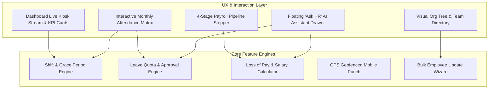
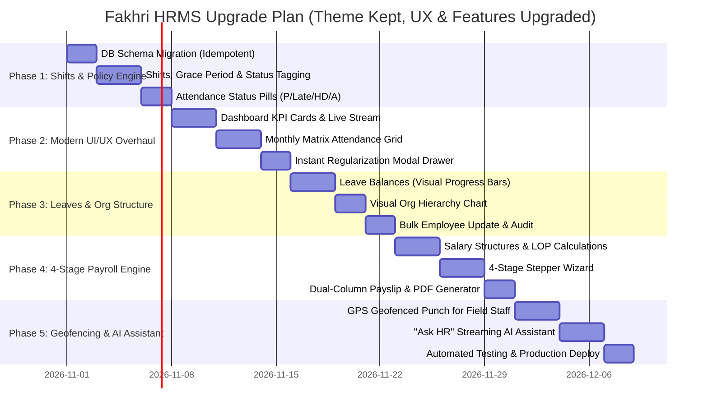

# Fakhri HRMS — Master Upgrade & Feature Enhancement Plan
## Reverse-Engineered from SignHR Architecture with Fakhri Brand Theme Preservation

> **Core Directive**: 
> 1. **Preserve Exact Brand Theme**: Keep Fakhri's signature **Maroon (`#870808`)** aesthetic, dense business UI, hairline borders, and neutral stone palette (`fakhriitservices.com` identity). **No purple or foreign brand colors.**
> 2. **Adopt Enterprise Features & Modern UX**: Integrate all high-value workflows, ergonomic layouts, interactive steppers, visual cards, and user experience enhancements discovered from SignHR.
> 3. **Retain Biometric Edge**: Maintain our native in-browser **ONNX YuNet + SFace** anti-spoofing facial recognition gate (<120ms identification, zero hardware cost).

---

## 1. Design & UX Strategy: Fakhri Brand with Enterprise Ergonomics

Instead of copying SignHR's purple color palette, we apply **SignHR's UX ergonomics and modern interaction patterns** to **Fakhri's signature brand design system**:

### 1.1 Fakhri Design System Tokens (Preserved & Enhanced)

| Design Token | CSS Variable | Hex Value | UI Role & Application |
| :--- | :--- | :--- | :--- |
| **Brand Primary** | `--primary` | `#870808` | Primary CTA buttons, active sidebar highlights, key metrics |
| **Brand Dark** | `--primary-dark` | `#6F0606` | Button hover states, emphasized headers |
| **Brand Light / Accent** | `--primary-light` | `#A90A0A` | Active tab indicators, interactive highlights |
| **Brand Soft Tint** | `--primary-soft` | `#FBF3F3` | Active row highlight, soft badge backgrounds |
| **Brand Soft Border** | `--primary-soft-border` | `#EFD3D3` | Selected card borders, input focus rings |
| **App Canvas / Surface** | `--surface` | `#F5F5F4` | Clean stone background canvas |
| **Card & Container** | `--card` | `#FFFFFF` | Crisp white elevated surfaces with hairline borders |
| **Hairline Borders** | `--border` / `--border-strong`| `#E7E5E4` / `#D6D3D1` | Subtle divider lines, table cell strokes |
| **Primary Typography** | `--ink` | `#18181B` | High-contrast readable headings and data values |
| **Secondary Typography**| `--muted` / `--faint` | `#71717A` / `#A1A1AA` | Subtitles, helper text, timestamps |

### 1.2 UX Attendance & Workflow Status Badges (Fakhri Palette)

| Status | Badge Background | Badge Border | Text Color | User Meaning |
| :--- | :--- | :--- | :--- | :--- |
| **Present (`P`)** | `#F0FDF4` | `#BBF7D0` | `#15803D` | Present & on-time |
| **Late (`Late`)** | `#FFFBEB` | `#FDE68A` | `#B45309` | Late arrival (shows tooltip with delay, e.g. "14m late") |
| **Half-Day (`HD`)** | `#FEF3C7` | `#FCD34D` | `#92400E` | Working hours < 4.5h |
| **Leave (`L`)** | `#EFF6FF` | `#BFDBFE` | `#1D4ED8` | Approved Casual/Sick/Paid Leave |
| **Absent / LOP (`A`)** | `#FEF2F2` | `#FECACA` | `#B91C1C` | Unapproved absence / Loss of Pay |
| **Holiday / Off (`–`)**| `#F4F4F5` | `#E4E4E7` | `#71717A` | Weekly off or gazetted holiday |

---

## 2. Key UX & Feature Upgrades (Adapted from SignHR)



---

### Feature 1: Modern Dashboard Home & Live Biometric Stream (`/dashboard`)
- **KPI Summary Metric Cards (Dense, Clean, Hairline style)**:
  - **Active Headcount**: Total active staff with department breakdown indicator.
  - **Today's Attendance Rate**: Live gauge (`92.8%`) showing `39 Present` • `2 Late` • `1 Leave`.
  - **Pending Approvals**: Quick notification pill for pending leaves and regularizations.
  - **Estimated Payroll Spend**: Real-time month-to-date estimated salary spend.
- **Live Biometric Kiosk Feed**:
  - Live activity card showing face punches in real-time as employees scan at the gate.
  - Shows employee photo, name, timestamp, and instant verification status (`PASS 0.89`).
- **Quick Action Bar**:
  - `+ Add Employee`, `Quick Regularize`, `Approve Leaves`, `Run Payroll`.

---

### Feature 2: Interactive Attendance Register Matrix (`/attendance`)
- **Monthly Matrix View**:
  - Employees as rows, days 1–31 as columns.
  - Compact, color-coded status pills (`P`, `Late`, `HD`, `L`, `A`, `–`).
  - Hovering on any `Late` pill shows exact arrival time and minutes late.
- **Instant Regularization Modal**:
  - Clicking any `Late` or `A` pill immediately opens a side drawer/modal to submit or approve regularization with reason remarks.
- **Smart Filter Toolbar**:
  - Instant filter by Department, Shift, Branch, and Attendance Status without full page reload.

---

### Feature 3: The "One Punch to Payday" 4-Stage Payroll Stepper (`/payroll/runs/new`)
A progressive, error-proof payroll calculation wizard in Fakhri's signature maroon theme:
$$\text{[1. Inputs Verified]} \longrightarrow \text{[2. Calculated]} \longrightarrow \text{[3. Approved]} \longrightarrow \text{[4. Locked & Distributed]}$$

- **Dual-Column Payslip Card**:
  - **Left Column (+ Earnings)**: Basic Salary, HRA, Special Allowance, Conveyance, Overtime.
  - **Right Column (− Deductions)**: Loss of Pay (LOP) auto-computed from unapproved absences, PF, ESI, Professional Tax (PT), TDS, Loan EMI.
- **1-Click Export Actions**:
  - 1-Click "Download All Payslips (ZIP)", "Bank Transfer NEFT CSV", "EPFO ECR Text File".

---

### Feature 4: Visual Leave Quota Cards & Workflows (`/leaves`)
- **Visual Leave Balances**:
  - Quota progress bars instead of plain text numbers:
    - **Paid Leave (PL)**: `9 / 15 days` (Clean primary progress bar).
    - **Sick Leave (SL)**: `5 / 7 days` (Teal progress bar).
    - **Casual Leave (CL)**: `3 / 8 days` (Amber progress bar).
- **Application Modal**:
  - Auto-calculates working days by skipping gazetted holidays and weekly offs.
- **Loss of Pay (LOP) Register**:
  - Dedicated transparent ledger linking unapproved absences to month-end salary deductions.

---

### Feature 5: Visual Organization Tree & Team Directory (`/employee/chart`)
- **Dynamic Hierarchy Tree**:
  - Interactive org chart showing Reporting Managers $\rightarrow$ Team Leads $\rightarrow$ Members.
  - Expand/collapse branches with active team headcount and role tags.
- **Bulk Employee Update Wizard (`/employee/team/bulk-update`)**:
  - Filter employees by department/shift and update managers, shifts, or salary slabs in batch.
  - Full audit history log tracking who made the changes and when.

---

### Feature 6: Geofenced Mobile Punch for Field & Remote Staff
- Complementing our in-browser **Biometric Face Kiosk** for office entry:
  - Mobile web punch with GPS coordinates verification against company branch radius (e.g. 150m).
  - Quick selfie capture to prevent buddy punching on mobile.

---

### Feature 7: "Ask HR" Agentic AI Assistant Drawer
- Integrated floating assistant drawer matching Fakhri's maroon UI.
- Answers natural language questions via streaming responses:
  - *"Kitni leaves bachi hain meri?"* (Checks employee leave balances).
  - *"Aaj kaun kaun late aaya?"* (Queries today's attendance logs).
  - *"Mera September ka payslip download karo."*

---

## 3. Database Schema Blueprint (SQLite WAL Mode)

All schemas are created idempotently (`CREATE TABLE IF NOT EXISTS`), ensuring **zero disruption** to existing employee data, face embeddings, and kiosk credentials.

```sql
-- 1. Shifts Master & Policies
CREATE TABLE IF NOT EXISTS shifts (
    id TEXT PRIMARY KEY,
    name TEXT NOT NULL,
    start_time TEXT NOT NULL,      -- '09:30'
    end_time TEXT NOT NULL,        -- '18:30'
    grace_minutes INTEGER DEFAULT 15,
    half_day_minutes INTEGER DEFAULT 270,
    overtime_min_minutes INTEGER DEFAULT 60,
    is_default BOOLEAN DEFAULT 0,
    created_at TIMESTAMP DEFAULT CURRENT_TIMESTAMP
);

-- 2. Leave Management & LOP Register
CREATE TABLE IF NOT EXISTS leave_types (
    id TEXT PRIMARY KEY,
    name TEXT NOT NULL,
    code TEXT NOT NULL UNIQUE,     -- 'CL', 'SL', 'PL', 'LWP'
    annual_days REAL NOT NULL DEFAULT 12,
    is_paid BOOLEAN DEFAULT 1,
    color TEXT DEFAULT '#870808'
);

CREATE TABLE IF NOT EXISTS leave_balances (
    id TEXT PRIMARY KEY,
    employee_id TEXT NOT NULL,
    leave_type_id TEXT NOT NULL,
    year INTEGER NOT NULL,
    allocated REAL NOT NULL,
    used REAL DEFAULT 0,
    remaining REAL NOT NULL,
    FOREIGN KEY(employee_id) REFERENCES employees(id),
    FOREIGN KEY(leave_type_id) REFERENCES leave_types(id)
);

CREATE TABLE IF NOT EXISTS leave_requests (
    id TEXT PRIMARY KEY,
    employee_id TEXT NOT NULL,
    leave_type_id TEXT NOT NULL,
    start_date DATE NOT NULL,
    end_date DATE NOT NULL,
    days_count REAL NOT NULL,
    reason TEXT NOT NULL,
    status TEXT DEFAULT 'pending', -- 'pending', 'approved', 'rejected'
    approved_by TEXT,
    rejection_reason TEXT,
    created_at TIMESTAMP DEFAULT CURRENT_TIMESTAMP,
    FOREIGN KEY(employee_id) REFERENCES employees(id)
);

CREATE TABLE IF NOT EXISTS lop_register (
    id TEXT PRIMARY KEY,
    month TEXT NOT NULL,           -- '2026-10'
    employee_id TEXT NOT NULL,
    absent_days REAL DEFAULT 0,
    half_days REAL DEFAULT 0,
    total_lop_days REAL NOT NULL,
    status TEXT DEFAULT 'unlocked',
    created_at TIMESTAMP DEFAULT CURRENT_TIMESTAMP,
    FOREIGN KEY(employee_id) REFERENCES employees(id)
);

-- 3. Salary Structures & 4-Stage Payroll
CREATE TABLE IF NOT EXISTS salary_structures (
    employee_id TEXT PRIMARY KEY,
    monthly_ctc REAL NOT NULL,
    basic_salary REAL NOT NULL,
    hra REAL DEFAULT 0,
    special_allowance REAL DEFAULT 0,
    transport_allowance REAL DEFAULT 0,
    pf_deduction REAL DEFAULT 0,
    esi_deduction REAL DEFAULT 0,
    pt_deduction REAL DEFAULT 0,
    tds_deduction REAL DEFAULT 0,
    tax_regime TEXT DEFAULT 'new',
    FOREIGN KEY(employee_id) REFERENCES employees(id)
);

CREATE TABLE IF NOT EXISTS payroll_records (
    id TEXT PRIMARY KEY,
    month TEXT NOT NULL,           -- '2026-10'
    employee_id TEXT NOT NULL,
    total_days INTEGER NOT NULL,
    payable_days REAL NOT NULL,
    lop_days REAL NOT NULL,
    gross_salary REAL NOT NULL,
    total_deductions REAL NOT NULL,
    net_salary REAL NOT NULL,
    status TEXT DEFAULT 'draft',   -- 'draft', 'calculated', 'approved', 'locked'
    pdf_path TEXT,
    created_at TIMESTAMP DEFAULT CURRENT_TIMESTAMP,
    FOREIGN KEY(employee_id) REFERENCES employees(id)
);

-- 4. Organization Departments & Hierarchy
CREATE TABLE IF NOT EXISTS departments (
    id TEXT PRIMARY KEY,
    name TEXT NOT NULL UNIQUE,
    head_employee_id TEXT,
    created_at TIMESTAMP DEFAULT CURRENT_TIMESTAMP
);

CREATE TABLE IF NOT EXISTS designations (
    id TEXT PRIMARY KEY,
    department_id TEXT NOT NULL,
    title TEXT NOT NULL,
    created_at TIMESTAMP DEFAULT CURRENT_TIMESTAMP,
    FOREIGN KEY(department_id) REFERENCES departments(id)
);

-- 5. Geofenced Restricted Zones
CREATE TABLE IF NOT EXISTS restricted_zones (
    id TEXT PRIMARY KEY,
    name TEXT NOT NULL,
    latitude REAL NOT NULL,
    longitude REAL NOT NULL,
    radius_meters REAL DEFAULT 150,
    is_active BOOLEAN DEFAULT 1,
    created_at TIMESTAMP DEFAULT CURRENT_TIMESTAMP
);
```

---

## 4. Execution Roadmap (Preserving Theme, Elevating UX)



---

## 5. Strict Quality & Safety Guarantees

1. **Brand Uniformity**:
   - Primary accents remain **Fakhri Maroon (`#870808`)** across buttons, active tab states, and navigation.
   - Clean, dense, hairline border styling (`--border: #e7e5e4`) is retained and unified across all new cards and modals.
2. **FaceAPI & Biometrics Untouched**:
   - Under no circumstances will the ONNX YuNet + SFace pipeline or biometric gallery be broken or slowed down. Latency remains **< 120ms**.
3. **Database Integrity**:
   - Zero data loss. Historical attendance records and existing enrolled faces remain fully intact.
4. **Test Pass Guarantee**:
   - All **330/330 automated tests** remain green at all stages of development.
